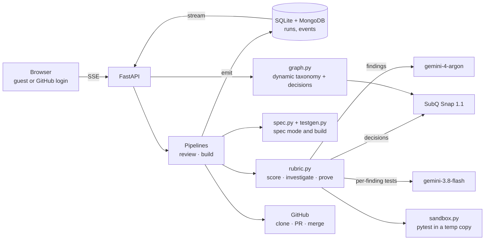

# 🛡️ PRProof

**Don't review AI code — review its proof.**

PRProof is an independent verifier for AI-written pull requests. It writes its own tests, runs them in a sandbox and reports a verdict backed by an executed failing test. Anything it cannot execute is labelled a heads-up, never claimed as proven. A proven failure sets a `prproof/verify` commit status, so branch protection can block the merge. It can also build a feature test-first and open the PR with the evidence.

## What you can do

| | |
|---|---|
| **Review any PR** (no sign-in needed for public repos) | Paste `owner/repo/pull/123`. PRProof explains the change in plain English, scores it against nine review categories with the SubQ decision model, investigates the flagged areas, then tries to **prove each finding by running a generated test**. Output is plain `Heading : value` lines: Verdict, Risk, Problem, Severity, Where, Why it matters, Proof, Fix. No specs required — if the repo has a `specs/` folder, spec conformance is added as extra evidence. |
| **Read a repo** | A readable report: tagline, what it is, stack, language bar, health checks (activity, tests, CI, license), what's worth knowing, what to watch out for. |
| **Explore my repos** (GitHub sign-in) | Your repos as a living map. **Categories are decided dynamically for you**: a taxonomy is proposed from *your* repos, then SubQ Snap decides each repo's category (with confidence), maturity and "likely abandoned". |
| **Pull requests** (no sign-in) | Type an owner or repo: open PRs grouped by repository or type and ranked by how much review they need (SubQ decisions). |
| **Build a feature** (GitHub sign-in; forks the repo when you cannot write; works with or without `specs/`) | Request → cited spec clauses (you approve) → plan → tests written first and shown red → implementation → same tests green → independent inspection → PR with an evidence table → approve or request changes (new round on the same PR). |

## Where the SubQ decision model is used

| Step | Question(s) | Why a decision model |
|---|---|---|
| Review rubric | One yes/no per category (9), one overall risk score, one "which single area is the main concern?" choice, over the whole diff in one call | Fast, cheap, calibrated probabilities over a large input |
| Repo categories | Per repo: category (choice over *your* taxonomy), maturity (score), abandoned-or-unfinished (yes/no) | Dynamic per user; returns confidence and runner-up categories |
| Clause routing (spec mode) | Per spec clause: does this change touch it? | Runs only relevant clause tests |

SubQ never writes code. Generation uses `gemini-4-argon` / `gemini-3.8-flash`.

## Review format and benchmark

The review shape is inspired by published AI-review practice (e.g. CodeRabbit's walkthrough summary and its *Severity · Category · Effort* comment header: Critical/Major/Minor/Trivial). PRProof adds a **Proof** row and an honest status per finding: `proven` (an executed test failed), `heads-up` (not proven), `cleared` (a test passed, so the suspicion was dropped). Categories that a behaviour test cannot prove (Tests, Maintainability) are never marked proven.

`python -m specguard bench` scores the rubric on nine labelled diffs (seven with a known issue, two clean) and writes `benchmarks/RESULTS.md`.
Latest run: main concern correct **7/9**, right category flagged **7/7**, clean changes left unflagged **2/2**. The yes/no questions alone flag ~3 extra categories on bad changes (noisy), which is why findings are investigated and proven before they are reported.

## Architecture



## Run it

```bash
pip install -r requirements.txt
cp .env.example .env        # fill in keys (never commit .env)
python -m specguard serve   # http://localhost:8000
python -m pytest tests      # 32 unit tests
```

- **GitHub OAuth App** (callback `http://localhost:8000/auth/callback`): set `GITHUB_CLIENT_ID` / `GITHUB_CLIENT_SECRET`. Dev only: `SPECGUARD_ALLOW_LOCAL_LOGIN=1` adds a sign-in link using your local `gh` token.
- **Guests** read public repos and get read-only reviews (3 free per session) through `PUBLIC_READ_TOKEN` (a read-only token). Guests can never post, build, or see private repos.
- **Execution limits:** proof by test runs for Python projects under ~150 MB. Other repos get the rubric and findings labelled "Not executed".

CLI: `python -m specguard review --repo owner/repo --pr 12 [--comment]`, `build --repo … --feature "…" --yes --dry`, `bench`.

## Built during the hackathon on Nov 7, 2026

Everything here was written today at the AIE Code Summit Hackathon: the event backbone (SQLite + MongoDB), the build pipeline (cited clauses → tests first → red→green → inspection → PR → feedback rounds), the spec-less review rubric with proof-by-test, the SubQ decision-model integrations, dynamic per-user repo categorisation, the relationship graph, guest mode, GitHub OAuth, the SSE live UI, the benchmark, and 32 unit tests (written first for the pure logic). The demo target `tinyjwt` is a separate repo with a seeded RFC 8725 timing-compare bug that PRProof's inspection finds and fixes on its own.

## Known limits (honest)

- Proof-by-test is Python-only today; other languages get findings without execution.
- LLM-written tests can be wrong. Mitigations: tests that error are regenerated once then dropped, a failing test is adjudicated against the finding, and passing tests *clear* a finding.
- Sessions live in server memory; restarting the server signs everyone out.
- Slack: a Socket Mode proof (`scripts/slack_proof.py`) works; the web app is the primary interface.
