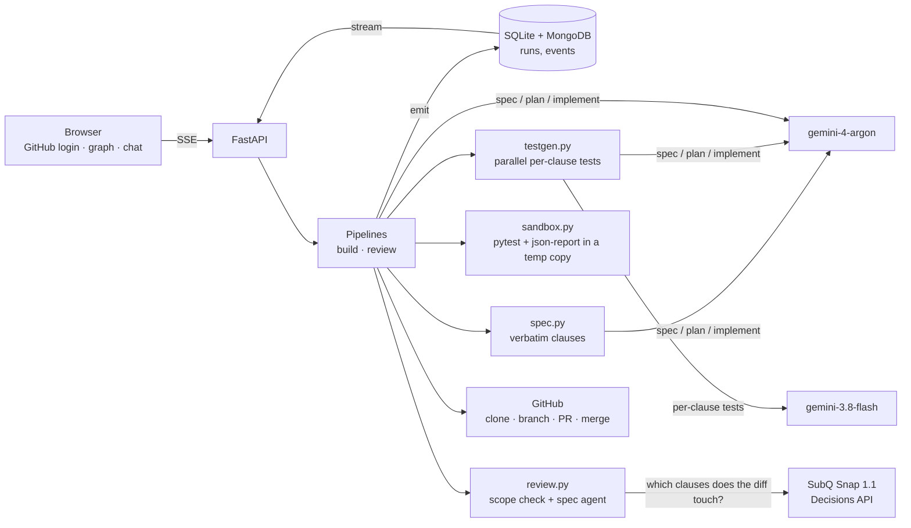

# 🛡️ SpecGuard

**Don't review AI code — review its proof.**

SpecGuard turns a feature request into spec clauses cited from the repo's own standards (RFCs, API contracts), writes the tests **first**, implements until they pass, and reviews any PR by *running tests*, never by guessing. A finding without a failing test never gets reported.

Sign in with GitHub, then pick one of three things:

| | |
|---|---|
| ✨ **Create a new feature** | Request → cited clauses (you approve) → plan → tests written first and shown **red** → implementation → same tests **green** + existing tests still pass → independent inspection → PR with an evidence table → you approve or request changes (new round on the same PR) → squash-merge. |
| 📖 **Read a repo** | Highlights, health, specs/tests presence, open PRs, and one-click proof-based PR review. |
| 🌌 **Explore my repos** | Every repo your GitHub identity can access as a live constellation: size = stars/size/issues, colour = language, green ring = you can write, dashed = private. Click a node to read it, build on it or review its PRs. |

A chat widget answers questions about a selected repo and about how a run works.

## The proof rules

- Every clause quote is checked to be **verbatim** from the repo's `specs/` (otherwise it is dropped).
- A generated test that **passes before implementation** is discarded as *non-discriminating* and reported as such.
- A test that **errors** because of a test bug (syntax / name / import / fixture) is regenerated once, then dropped and reported as *untestable*. A missing API at call time is a legitimate red.
- After implementation, an assertion failure is only a *candidate*; an adjudicator model checks it against the clause quote before it is reported.
- The same test must flip **fail → pass**; that flip is the evidence. Green is never claimed without an actual run.
- **Review = one spec agent + a deterministic scope check** (access + sensitive paths such as `.github/workflows`, CI, `.env`, keys) shown as one summary line.
- Secrets are redacted from every event; GitHub tokens live in server memory for the session only.

## Architecture



Models: `gemini-4-argon` (spec, plan, implementation — `thinking_level` high only on retries and inspection fixes), `gemini-3.8-flash` (parallel per-clause test generation, repo highlights, chat), `gemini-3.5-flash-lite` (fallback classifier), and **SubQ Snap 1.1** (Decisions API) to route a change to the spec clauses it touches — one yes/no question per clause over the whole diff plus changed files in a single call. Every LLM output is cached on disk by input hash (`--fresh` bypasses).

## Run it

```bash
pip install -r requirements.txt
cp .env.example .env        # fill in keys (never commit .env)
python -m specguard serve   # http://localhost:8000
```

Register a GitHub OAuth App (Settings → Developer settings → OAuth Apps) with callback `http://localhost:8000/auth/callback` and set `GITHUB_CLIENT_ID` / `GITHUB_CLIENT_SECRET`.
Dev-only shortcut: `SPECGUARD_ALLOW_LOCAL_LOGIN=1` adds a sign-in link that uses your local `gh` CLI token.

Target repos need markdown specs under `specs/` (see [tinyjwt](https://github.com/Naveenaduri/tinyjwt) — a small HS256 JWT library with RFC 7519/7515/8725 excerpts, used as the demo target).

CLI (same engine, same events):

```bash
python -m specguard build  --repo Naveenaduri/tinyjwt --feature "add audience (aud) claim validation" --yes --dry
python -m specguard review --repo Naveenaduri/tinyjwt --pr 1 [--comment]
python -m pytest tests          # SpecGuard's own unit tests
python scripts/smoke_models.py  # calls every model once
```

## Built during the hackathon on Nov 7, 2026

Everything in this repository was written today during the AIE Code Summit Hackathon:

- Event backbone (`emit()` → SQLite + MongoDB) with secret redaction
- Spec handling with verbatim-quote verification, clause selection and extraction
- Parallel test-first generation, red classification, regeneration and "untestable / non-discriminating" reporting
- Pytest sandbox with per-test results (test-bug vs. real failure)
- Build pipeline: spec gate → plan → red → implement (retry with high thinking) → green → independent inspection → PR with evidence table → human review rounds → squash-merge
- Review engine: deterministic scope check + SubQ-routed clause mapping + adjudicated proven violations
- FastAPI app with GitHub OAuth, SSE run streaming, repo highlights, chat
- Web UI: repo constellation graph, live pipeline view with prominent violation and red→green moments
- Unit tests written first for the pure parts (TDD)
- The demo target `tinyjwt` (separate repo) with a seeded RFC 8725 timing-compare bug that SpecGuard's inspection finds and fixes on its own

## Slack

A Socket Mode Slack front end for the same engine is proven (mention → thread reply, button → action, `chat.update`) in `scripts/slack_proof.py`; the web app is the primary interface.
